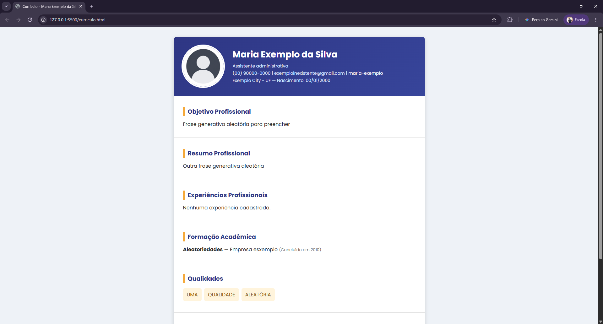

# Gerador de Currículo em HTML

Programa em **Python** que roda no terminal, faz perguntas sobre você e gera um **currículo em HTML** pronto para abrir no navegador e imprimir ou salvar como PDF. Não usa bibliotecas externas, só o Python.

**Demonstração em vídeo:** [assistir](https://youtu.be/FOc6DmjdWkE?si=wPejF5W_ZUxa6_crhttps://youtu.be/FOc6DmjdWkE?si=wPejF5W_ZUxa6_cr)
**Exemplo do resultado:** [ver currículo gerado](https://lucasfbsdev8.github.io/NOME-DO-PORTFOLIO/exemplos/curriculo.html) (dados fictícios)



## O que ele faz

O script pergunta, em etapas:

1. **Dados pessoais:** nome, nascimento, cidade/UF, telefone, e-mail, LinkedIn e foto
2. **Dados profissionais:** cargo pretendido, objetivo, resumo e quantas experiências você quiser
3. **Formação acadêmica:** uma ou mais, concluídas ou em andamento
4. **Qualidades**
5. **Idiomas**, com o nível de cada um

No fim, monta o `curriculo.html` com cabeçalho, foto redonda, seções organizadas e visual pronto para impressão.

## Como rodar

Requisito: **Python 3.8 ou superior**.

```bash
git clone https://github.com/lucasfbsdev8/gerador-curriculo-python
cd gerador-curriculo-python
python curriculo.py
```

Antes de começar, coloque **sua foto na mesma pasta** do `curriculo.py` (por exemplo `foto.jpg`). Depois, abra o `curriculo.html` gerado no navegador.

## Como responder

- Nas listas (experiências, qualidades e idiomas), digite `fim` para encerrar.
- Na formação, a situação precisa ser exatamente **`Concluído`** (com a inicial maiúscula e o acento) ou **`Em Andamento`**. Se for "Concluído", o programa pede o ano. Se não, pede a data de início e a previsão de término.
- No campo da foto, informe só o nome do arquivo, como `foto.jpg`.
- No campo do LinkedIn, informe só o usuário (a parte depois de `/in/`).
- A pergunta "Adicionar outra formação?" aceita `S` ou `N`.

## Arquivos

| Arquivo | Função |
|---|---|
| `curriculo.py` | O programa inteiro |
| `pessoais.txt`, `profissionais.txt`, `formacao.txt`, `qualidades.txt`, `idiomas.txt` | Criados na execução, guardam as respostas |
| `curriculo.html` | O currículo gerado |

## Como funciona por dentro

O código é dividido em funções, uma para cada etapa:

- `ler_dados_pessoais()`, `ler_dados_profissionais()`, `ler_dados_academicos()`, `ler_qualidades()` e `ler_idiomas()` fazem as perguntas e gravam as respostas em arquivos `.txt`, usando `|` para separar os campos
- `gerar_curriculo_html()` lê esses arquivos de volta, monta o HTML linha por linha e salva o `curriculo.html`
- `main()` chama tudo na ordem certa

O projeto pratica leitura e escrita de arquivos, funções, repetição, listas e tuplas, e geração de HTML a partir de dados.

## Privacidade

Os arquivos `.txt` e o `curriculo.html` guardam **dados pessoais** (telefone, e-mail, nascimento). Eles estão no `.gitignore` e **não devem ser enviados ao GitHub**:

```
pessoais.txt
profissionais.txt
formacao.txt
qualidades.txt
idiomas.txt
curriculo.html
```

## Limitações e melhorias possíveis

- [ ] Aceitar "concluido" sem acento ou em minúsculas
- [ ] Validar e-mail, telefone e data de nascimento
- [ ] Impedir que caracteres como `<` e `|` digitados nas respostas quebrem o HTML ou os arquivos
- [ ] Permitir mais de um tema de cores
- [ ] Versão web com formulário, rodando direto no navegador

## Autor

[Lucas Fernandes](https://github.com/lucasfbsdev8), estudante de Sistemas de Informação.
